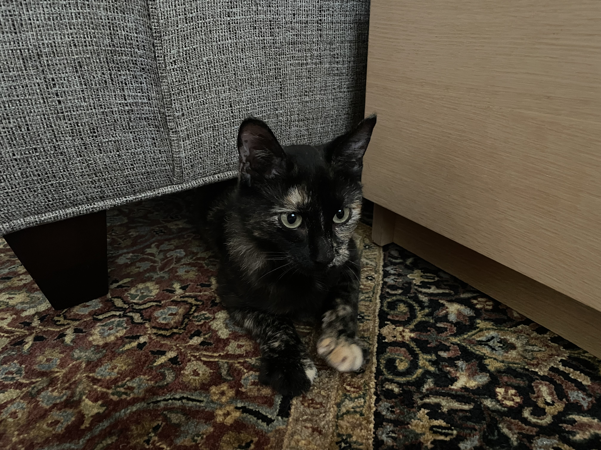

# About Me

## Background

I am an Assistant Professor in the Department of Mathematics, Statistics and Computer Science at Macalester College. I use she/her/hers pronouns. Prior to joining Macalester, I completed my PhD in Biostatistics at the University of Michigan and my undergraduate degree at Carleton College.

## Interests

My theoretical research sits at the intersection of machine learning, survival analysis, recurrent events, and longitudinal analysis. Please see my [CV](/Professional_CV.pdf) for more information.

## Education
B.A.-Mathematics with a minor in Women's and Gender Studies, Carleton College

M.S.-Biostatistics, University of Michigan

Ph.D.-Biostatistics, University of Michigan

## Outside of Work

You can find me running, playing volleyball, reading, or doing any number of crafts (knitting, ceramics, sewing, quilting, drawing, baking to name a few). I also adore my cat (ask me about her in office hours!)

**Contact Information:**

- **Email:** aloe [at] macalester [dot] edu
- **Office:** Olin-Rice Science Center 121
- **Phone:** +1-651-696-6430
